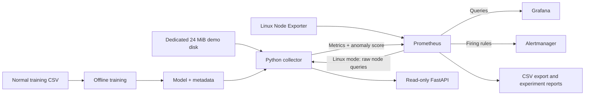

# Sentinel: Predictive Server Resource Monitoring

## Abstract

Sentinel combines resource monitoring, short-horizon disk capacity forecasting, and unsupervised anomaly detection. A Python service exports CPU, RAM, selected-filesystem usage and Isolation Forest scores. Prometheus stores samples and evaluates alerts; Grafana visualizes trends; Alertmanager groups active alerts. A bounded disk-fill experiment compares a predictive warning with a conventional usage threshold. The project also includes artifact-based model training, repeatable evaluation, container deployment and CI/CD.

The objective is **early warning of disk capacity exhaustion and detection of unusual resource behaviour**. It does not claim to predict arbitrary hardware faults or server crashes.

## Requirements and acceptance criteria

| Requirement | Acceptance evidence |
|---|---|
| Observe CPU, RAM and one filesystem | Grafana resource panels and `/api/status` |
| Forecast rising disk utilization | Prometheus `predict_linear` rule, unit tests |
| Warn before a measured 95% crossing | `reports/live-demo.json`, positive predictive lead time |
| Compare against a fixed threshold | Same report, `DiskUsageHigh` timestamps |
| Detect anomalous resource windows | Saved Isolation Forest artifact and held-out scores |
| Make model provenance inspectable | Source SHA-256, feature names and versions in model metadata |
| Treat missing data as a fault | Exporter-down and collection-stale alerts |
| Reproduce deployment | Compose, Jenkinsfile, GitHub Actions, Terraform, Ansible |

## Architecture

Demo mode measures CPU and RAM in the Docker Linux environment and usage of the isolated tmpfs. Linux mode samples one Node Exporter target through Prometheus and monitors `/`; it never fills that filesystem. The service API is bound to localhost and provides health, readiness, status, recent samples and OpenAPI documentation.

Prometheus evaluates alerts. Grafana displays their state and history. Alertmanager receives them. Email/Slack delivery is intentionally unconfigured until an actual receiver is supplied.

## Data and features

The shared schema is `timestamp_utc,host,cpu_pct,ram_pct,disk_used_pct`, with optional `run_id,scenario,label`. UTC timestamps are timezone-aware, percentages finite and within 0–100. Sampling is every 2 seconds. Each feature window contains 10 consecutive samples (18 seconds between first and last sample). For each resource, the feature vector contains its mean, standard deviation and least-squares slope in percentage points per second: nine features total.

Training and serving import the same feature function. Windows reset on host/run changes or sample gaps; reversed/duplicate timestamps are rejected. Online readiness is withdrawn when collection fails. The image has a **synthetic demonstration model**, not a model calibrated to a real host. Record normal activity and retrain before interpreting real anomaly alerts.

Demo CPU uses psutil's interval CPU percentage; demo RAM uses psutil's virtual-memory utilization. Linux CPU uses average non-idle utilization over 1 minute, RAM uses `1 - MemAvailable/MemTotal`, and disk uses `1 - available_bytes/size_bytes` for the root mount. These collection modes have different CPU semantics and require separate training baselines.

## Forecast and alert logic

Demo forecast: `predict_linear(server_disk_usage_percent[30s], 25)`, warning at a projected 95% with a positive slope for 6 seconds while actual usage remains below 95%. Baseline: actual disk usage >=90% for 2 seconds.

Linux mode uses a 5-minute lookback, 10-minute forecast and 30-second predictive hold; the baseline hold is 10 seconds. These are starting parameters, not universally validated operational thresholds. Forecasts assume a continuing approximately linear trend; bursty writes and cleanup can invalidate them.

Resource anomalies use `-IsolationForest.decision_function(window)`. A score above zero indicates an outlier relative to the saved training baseline. A 10-second hold reduces brief alert bursts. The score is neither a calibrated failure probability nor a remaining-life estimate.

Freshness checks suppress resource alerts when collection becomes stale; separate critical alerts cover exporter unavailability and a reachable exporter with stalled collection. No automatic remediation or file deletion occurs as a consequence of an alert.

## Model and evaluation method

Isolation Forest uses 200 trees, contamination 0.02, random seed 42 and one training worker. It learns normal training windows only. The contamination parameter helps set a training-relative decision threshold; it does not guarantee a 2% false-positive rate on another host.

Four independent synthetic normal training runs and four held-out test runs use separate seeds and run IDs. Test scenarios include normal activity, a short CPU/RAM spike and sustained disk growth. The model is not refit on test windows. Labels describe the last sample in each window, which makes anomaly recovery windows a potential source of false positives. Overlapping windows are correlated, so these counts are not independent trials.

See `reports/evaluation.md` and `reports/evaluation.json` for generated precision, recall, F1, confusion counts and normal-window false-positive rate. These measure **synthetic window classification**, not alert-event accuracy on real failures. A stronger final submission should repeat evaluation on separately collected real runs and report normal alert events/hour, not only flagged windows.

For online capacity evaluation, run the bounded experiment, query actual Prometheus alert history and record:

`warning lead time = first sampled usage >=95% time - first alert firing time`

A negative value means the alert arrived after the sampled crossing. Report absent alerts as missing, not as zero. An anomaly alert already active before the experiment is not credited with warning lead time. Sampling and rule evaluation each introduce timing uncertainty.

## Engineering and reproducibility

Containers have pinned service tags and pinned primary Python dependencies. The collector runs as a non-root user with read-only root filesystem and dropped capabilities. Prometheus, Grafana and Alertmanager use named volumes. HTTP ports bind to localhost. Grafana requires authentication with a generated local password; `.env` and model binaries are excluded from Git. Load only trusted joblib artifacts.

Jenkins trains, evaluates, tests, validates Prometheus rules and builds an image. Optional deployment ships that image over verified SSH to a prepared EC2 host and runs smoke tests. Terraform configures an encrypted Ubuntu EC2 instance in a supplied VPC/subnet, requires IMDSv2 and permits inbound SSH only from the configured administrative network. Ansible installs Docker and creates the deployment directory.

## Limitations and future work

- Synthetic ML fixtures do not establish real-world failure prediction performance. Isolation Forest can miss changes in features that were constant throughout training; the locally calibrated model did not raise an ML alert during the repeated disk-fill test. The independent capacity forecast did raise an early warning.
- One host and one filesystem are supported initially; adding hosts requires explicit target/label selection, independent windows and per-host calibration.
- Linux host monitoring has been verified on the existing Ubuntu 26.04 t3.micro EC2 instance through a successful Jenkins deployment and live dashboard-query checks. Broader operational reliability and real-host ML quality still require evaluation.
- No high availability, automated model retraining, drift detection, TLS reverse proxy or tested external notification receiver is included.
- Future evaluation should include variable fill rates, cleanup, plateau periods, gaps, benign workload shifts and repeated test runs with confidence intervals.
- Model warnings require human inspection; automated remediation is outside this project's scope.

## References

- [Prometheus forecasting functions](https://prometheus.io/docs/prometheus/latest/querying/functions/#predict_linear)
- [Node Exporter](https://github.com/prometheus/node_exporter)
- [Isolation Forest API](https://scikit-learn.org/stable/modules/generated/sklearn.ensemble.IsolationForest.html)
- [Grafana provisioning](https://grafana.com/docs/grafana/latest/administration/provisioning/)
- [Jenkins Pipeline](https://www.jenkins.io/doc/book/pipeline/jenkinsfile/)
